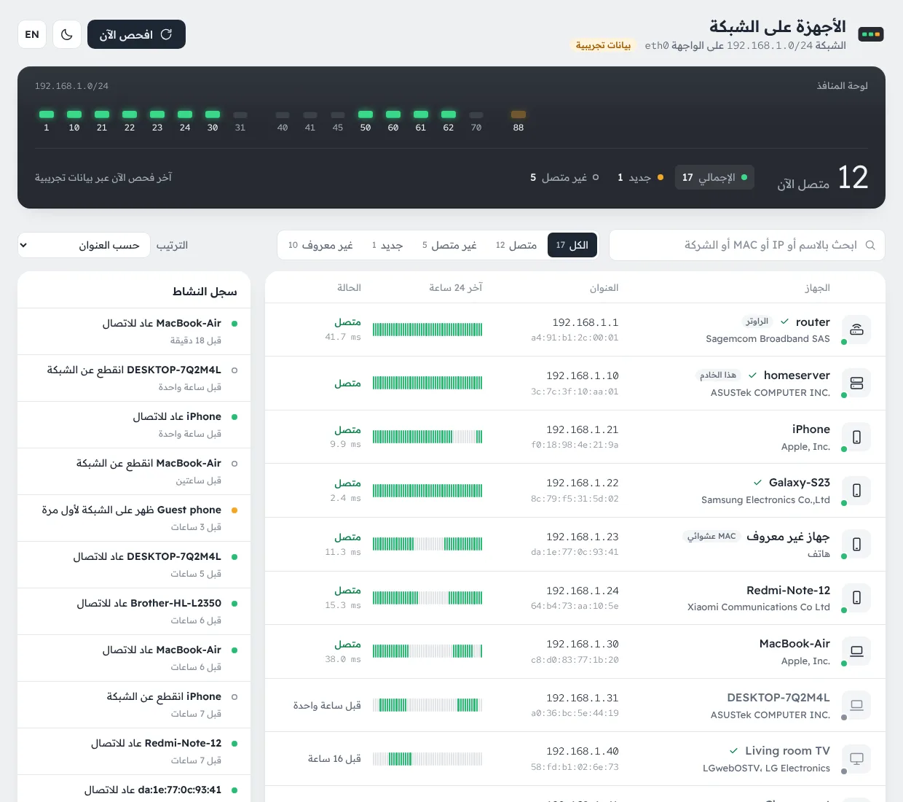
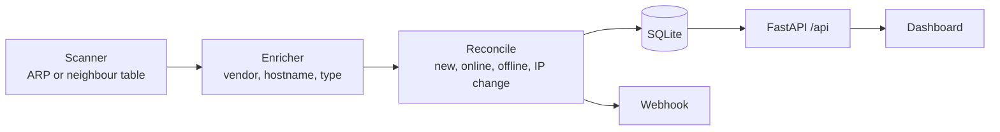

<div align="center" dir="rtl">

# LanWatch

**اعرف ما هي الأجهزة المتصلة بشبكتك الآن.**

لوحة ويب خفيفة تستضيفها بنفسك، تكتشف كل جهاز على شبكتك المحلية، وتتذكر كل جهاز باسمه، وتنبهك فور ظهور جهاز جديد.

[English](README.md) · العربية



</div>

<div dir="rtl">

## المزايا

- **لوحة منافذ حيّة** على شكل واجهة الراوتر: ضوء LED لكل جهاز مرتب حسب IP. الأخضر متصل، والبرتقالي الوامض جديد، والمطفأ غير متصل.
- **سجل الأجهزة**: الاسم، والشركة المصنعة، واسم المضيف، وIP وMAC، وزمن الاستجابة، وشريط تواجد لآخر 24 ساعة يميّز بين «غائب» و«لا توجد بيانات».
- **سجل النشاط**: جهاز جديد، عاد للاتصال، انقطع، أو غيّر عنوانه.
- **تعريف أجهزتك**: سمِّها، وثبّت نوعها، وعلّمها كـ «معروف»، وأضف ملاحظات.
- **معرفة الشركة المصنعة دون إنترنت** من قاعدة IEEE OUI المضمّنة، وأسماء المضيف عبر reverse DNS من الراوتر، وتحديد نوع الجهاز تلقائياً (هاتف، حاسوب، تلفاز، طابعة، كاميرا، قابس ذكي…).
- **كشف عناوين Wi-Fi الخاصة**: عناوين MAC العشوائية تُوسَم بوضوح بدل أن تبدو مريبة.
- **Webhook عند ظهور جهاز جديد** إلى n8n أو Home Assistant أو Slack أو أي خدمة تقبل JSON.
- **الإنجليزية افتراضياً والعربية مدمجة**: الترجمات ملفات JSON مستقلة مع رجوع تلقائي للإنجليزية، ودعم كامل للاتجاه من اليمين لليسار.
- **وضع داكن**، ودعم لوحة المفاتيح، ومتوافق مع الجوال.
- **مستقل تماماً**: بلا build step ولا CDN، والخطوط مضمّنة، ولا يخرج شيء من شبكتك.
- **أقل صلاحيات ممكنة**: يعمل بـ `CAP_NET_RAW` فقط، وإن لم تتوفر ينتقل لطريقة بديلة بلا صلاحيات.

## التشغيل السريع

يجب أن يعمل LanWatch على جهاز داخل الشبكة التي تريد مراقبتها (سيرفر منزلي أو NAS أو Raspberry Pi)، وبوضع host network، لأن ARP لا يعمل إلا على واجهة الشبكة الحقيقية.

### Docker

```bash
docker run -d --name lanwatch --restart unless-stopped \
  --network host --cap-drop ALL --cap-add NET_RAW \
  -e LW_AUTH=admin:change-me \
  -v lanwatch-data:/data \
  ghcr.io/dev1bms/lanwatch:latest
```

ثم افتح `http://<server-ip>:8090`. الصور متوفرة لـ `linux/amd64` و`linux/arm64`.

### Docker Compose

```yaml
services:
  lanwatch:
    image: ghcr.io/dev1bms/lanwatch:latest
    container_name: lanwatch
    restart: unless-stopped
    network_mode: host
    cap_drop: [ALL]
    cap_add: [NET_RAW]
    security_opt: ["no-new-privileges:true"]
    environment:
      LW_AUTH: admin:change-me
      TZ: Europe/Madrid
    volumes:
      - ./data:/data
```

للبناء من المصدر: انسخ المستودع ثم شغّل `docker compose up -d --build`، وضع الإعدادات في `.env` (انظر [`.env.example`](.env.example)).

### بدون Docker

```bash
pipx install git+https://github.com/dev1bms/lanwatch.git
LW_DB_PATH=~/.local/share/lanwatch/lanwatch.db lanwatch
```

عند تشغيله كمستخدم عادي لا يملك صلاحية raw sockets، فيستخدم طريقة جدول الجيران البديلة. لفحص ARP دقيق شغّله عبر [`deploy/lanwatch.service`](deploy/lanwatch.service)، الذي يشغّله تحت systemd كمستخدم بلا صلاحيات ما عدا `CAP_NET_RAW`:

```bash
sudo useradd --system --home /opt/lanwatch lanwatch
sudo python3 -m venv /opt/lanwatch/.venv
sudo /opt/lanwatch/.venv/bin/pip install git+https://github.com/dev1bms/lanwatch.git
sudo cp deploy/lanwatch.service /etc/systemd/system/
sudo systemctl enable --now lanwatch
```

تريد التجربة أولاً؟ ضع `LW_DEMO=true` لتحصل على شبكة منزلية وهمية مع سجل يوم كامل.

## الإعدادات

كل الإعدادات متغيرات بيئة (أو ملف `.env` في مجلد التشغيل).

| المتغير | الافتراضي | الوصف |
|---|---|---|
| `LW_INTERFACE` | تلقائي | واجهة الشبكة، تُكتشف من الـ default route |
| `LW_SUBNETS` | تلقائي | نطاقات مفصولة بفاصلة مثل `192.168.1.0/24`، بحد أقصى `/16` |
| `LW_SCAN_INTERVAL` | `60` | الثواني بين كل فحص (من 10 إلى 3600) |
| `LW_OFFLINE_AFTER` | `300` | مدة الصمت قبل اعتبار الجهاز غير متصل |
| `LW_SCAN_METHOD` | `auto` | `arp` أو `neigh` أو `auto` (ARP مع بديل تلقائي) |
| `LW_HOST` / `LW_PORT` | `0.0.0.0` / `8090` | عنوان ومنفذ الواجهة |
| `LW_AUTH` | — | `user:password` لتفعيل Basic Auth للواجهة والـ API |
| `LW_RESOLVE_HOSTNAMES` | `true` | جلب أسماء الأجهزة عبر reverse DNS |
| `LW_HISTORY_DAYS` | `7` | مدة الاحتفاظ بسجل التواجد |
| `LW_WEBHOOK_URL` | — | يستقبل `POST` بصيغة JSON لكل جهاز جديد |
| `LW_ARP_TIMEOUT` / `LW_ARP_RETRY` | `2` / `2` | الموازنة بين سرعة الفحص ودقته |
| `LW_DB_PATH` | `/data/lanwatch.db` | مكان قاعدة بيانات SQLite |
| `LW_LOG_LEVEL` | `INFO` | `DEBUG` أو `INFO` أو `WARNING` أو `ERROR` |
| `LW_DEMO` | `false` | شبكة وهمية لتجربة الواجهة |

إذا كانت الشبكة المكتشفة أوسع من `/22`، يُفحص نطاق `/24` حول السيرفر فقط مع تنبيه في الواجهة. لفحص أوسع حدّد `LW_SUBNETS`.

## الأمان

قائمة كل أجهزة بيتك بعناوينها معلومة حساسة. مع وضع host network تستمع الواجهة على عنوان السيرفر في الشبكة المحلية.

- فعّل `LW_AUTH` دائماً إذا كانت اللوحة متاحة من خارج شبكتك المحلية.
- الأفضل الوصول إليها عبر VPN مثل Tailscale أو WireGuard بدل فتحها على الإنترنت.
- إن نشرتها عبر reverse proxy أو Cloudflare Tunnel، ضع أمامها طبقة تحقق هوية مثل Cloudflare Access.
- قيّد المنفذ بالجدار الناري، مثلاً `ufw allow from 192.168.1.0/24 to any port 8090`.

## كيف يعمل

</div>



<div dir="rtl">

1. كل `LW_SCAN_INTERVAL` ثانية يُرسل طلب ARP لكل عنوان في النطاق، ويُعرَّف كل جهاز بعنوان MAC الذي يبقى ثابتاً حتى لو تغيّر الـ IP.
2. بدون `CAP_NET_RAW` يرسل LanWatch حزمة UDP فارغة لكل عنوان كي تحلّها النواة، ثم يقرأ جدول الجيران. هذه الطريقة أقل دقة، وتُظهر الواجهة تنبيهاً بذلك.
3. خطوة مطابقة نقية (pure function) تقارن نتيجة الفحص بما هو معروف وتُنتج الأحداث. لا يُعتبر الجهاز غير متصل إلا بعد صمت يتجاوز `LW_OFFLINE_AFTER`، لأن الهواتف في وضع توفير الطاقة تتجاهل أحياناً طلب ARP منفرداً.
4. الفحص الفاشل يُسجَّل، لكنه لا يجعل أي جهاز غير متصل.

### الحدود

- لا يرى إلا الأجهزة في نفس شبكة Layer 2. شبكة الضيوف، وأي VLAN منفصلة، ونقاط الوصول المفعّل فيها عزل العملاء تبقى مخفية.
- الهواتف بعنوان Wi-Fi خاص قد تظهر كجهاز جديد بعد تغيير عنوان MAC.
- أسماء المضيف تعتمد على أن الراوتر ينشر أسماء DHCP في DNS، وكثير من راوترات المزوّدين لا تفعل ذلك.

## الـ API

توثيق OpenAPI التفاعلي متاح على `/api/docs`.

| Method | Path | الوصف |
|---|---|---|
| `GET` | `/api/state` | الشبكة وحالة الفحص والإحصاءات والأجهزة وآخر الأحداث في طلب واحد |
| `GET` | `/api/devices` | الأجهزة مع شريط التواجد لآخر 24 ساعة |
| `GET` | `/api/events?limit=50` | آخر الأحداث، الأحدث أولاً |
| `POST` | `/api/scan` | طلب فحص فوري |
| `PATCH` | `/api/devices/{mac}` | تعديل `alias` و`dev_type` (أو `auto`) و`known` و`notes` |
| `DELETE` | `/api/devices/{mac}` | حذف جهاز وسجله |
| `GET` | `/api/health` | فحص الصحة، مفتوح دائماً |

## التطوير

```bash
git clone https://github.com/dev1bms/lanwatch.git && cd lanwatch
python -m venv .venv && . .venv/bin/activate
pip install -e ".[dev]"

ruff check . && ruff format --check . && mypy && pytest
LW_DEMO=true LW_DB_PATH=./data/demo.db lanwatch
```

الواجهة مكتوبة بـ ES modules عادية داخل `src/lanwatch/static`: عدّل ثم حدّث الصفحة، لا يوجد ما يُبنى.

### الترجمات

نصوص الواجهة موجودة في `src/lanwatch/static/locales/<lang>.json`. الإنجليزية (`en.json`) هي المرجع والبديل لأي مفتاح ناقص، والعربية لغة ثانية مدمجة. لإضافة لغة جديدة:

1. انسخ `en.json` إلى `<lang>.json` وترجم القيم مع الحفاظ على كل `{placeholder}`.
2. سجّلها في `LANGUAGES` داخل `src/lanwatch/static/js/i18n.js` مع اسمها واتجاه النص والـ locale.
3. شغّل `pytest tests/test_locales.py`، وهو يفشل عند وجود مفتاح ناقص أو زائد أو اختلاف في المتغيرات.

## شكر وتقدير

استفاد LanWatch من أفكار مشروعين ممتازين، وإن احتجت ميزات أكثر فهما يستحقان التجربة:

- [WatchYourLAN](https://github.com/aceberg/WatchYourLAN): فحص ARP بوضع host network وسجل الاتصال والانقطاع.
- [NetAlertX](https://github.com/netalertx/NetAlertX): إطار كامل للتواجد والتنبيهات مع plugins وتكاملات.

## الرخصة

[MIT](LICENSE). الخطوط المضمّنة (Readex Pro وRed Hat Mono) مرخّصة تحت SIL Open Font License، انظر `src/lanwatch/static/fonts`.

</div>
