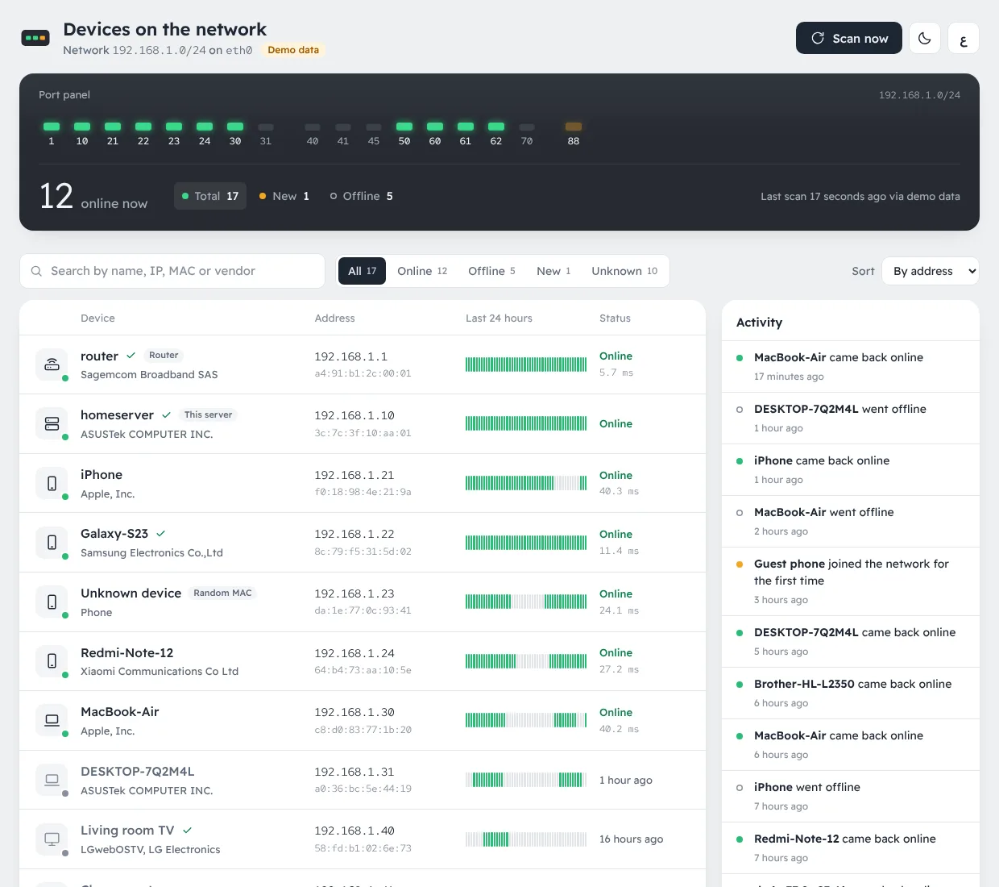
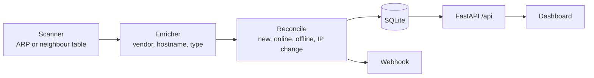
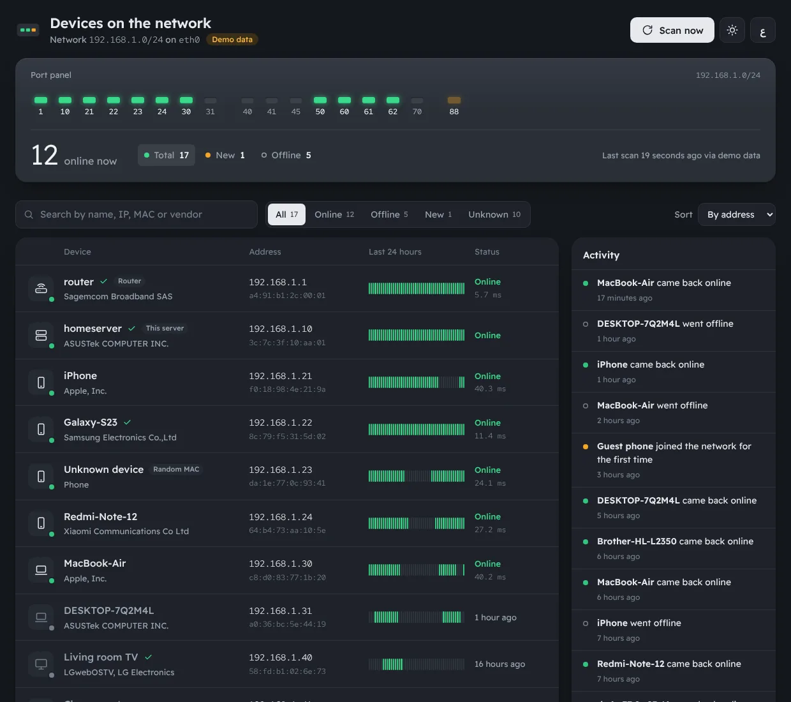
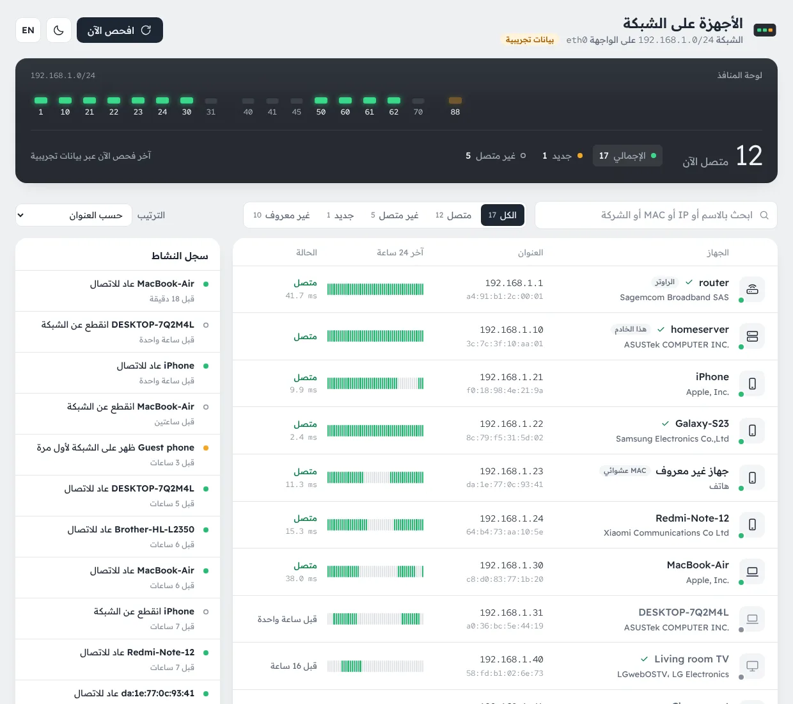
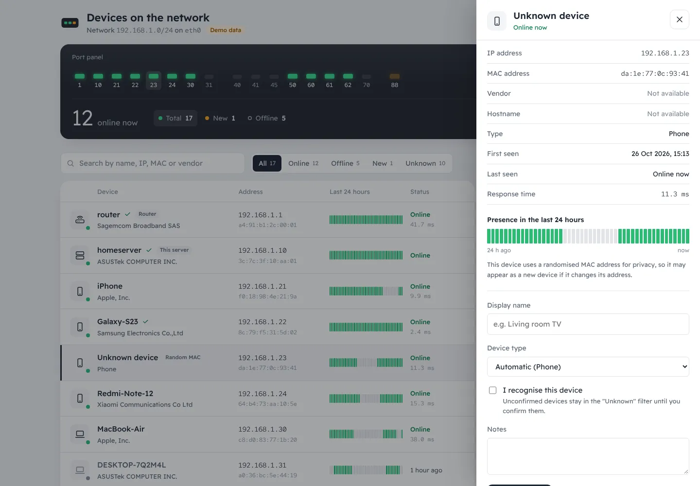
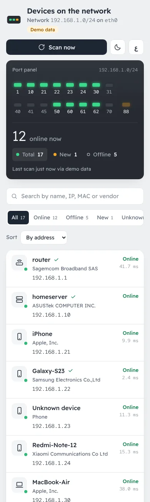

<div align="center">

# LanWatch

**See which devices are on your local network right now.**

A lightweight, self-hosted dashboard that discovers every device on your LAN, remembers who is who,
and tells you the moment something new shows up.

[](https://github.com/dev1bms/lanwatch/actions/workflows/ci.yml)
[](LICENSE)

[](https://github.com/dev1bms/lanwatch/pkgs/container/lanwatch)

English · [العربية](README.ar.md)



</div>

## Features

- **Live port panel** in the style of a router's front panel: one LED per device, ordered by IP. Green is online, blinking amber is new, dark is offline.
- **Device register** with name, vendor, hostname, IP, MAC, response time and a 24-hour presence strip that tells "absent" apart from "no data".
- **Activity feed** for new devices, devices coming back, going offline, or changing address.
- **Recognise your devices**: rename them, pin their type, mark them as known and keep notes.
- **Offline vendor lookup** from the bundled IEEE OUI registry, hostnames through your router's reverse DNS, and automatic device-type detection (phone, laptop, TV, printer, camera, smart plug, ...).
- **Private Wi-Fi address detection**, so randomised MACs are labelled instead of looking suspicious.
- **New-device webhook** for n8n, Home Assistant, Slack or anything that accepts JSON.
- **English by default, Arabic built in**: translations are plain JSON catalogs with English fallback, and the layout is fully right-to-left aware.
- **Dark mode**, keyboard accessible and mobile friendly.
- **Self-contained**: no build step, no CDN, fonts bundled. Nothing leaves your network.
- **Least privilege**: runs with `CAP_NET_RAW` only, and falls back to an unprivileged method when even that is unavailable.

## Quick start

LanWatch must run on a machine inside the network you want to watch (a home server, NAS or Raspberry Pi), with host networking, because ARP only works on the real LAN interface.

### Docker

```bash
docker run -d --name lanwatch --restart unless-stopped \
  --network host --cap-drop ALL --cap-add NET_RAW \
  -e LW_AUTH=admin:change-me \
  -v lanwatch-data:/data \
  ghcr.io/dev1bms/lanwatch:latest
```

Open `http://<server-ip>:8090`. Images are published for `linux/amd64` and `linux/arm64`.

### Docker Compose

```yaml
services:
  lanwatch:
    image: ghcr.io/dev1bms/lanwatch:latest
    container_name: lanwatch
    restart: unless-stopped
    network_mode: host
    cap_drop: [ALL]
    cap_add: [NET_RAW]
    security_opt: ["no-new-privileges:true"]
    environment:
      LW_AUTH: admin:change-me
      TZ: Europe/Madrid
    volumes:
      - ./data:/data
```

To build from source instead, clone the repository and run `docker compose up -d --build` (settings go in `.env`, see [`.env.example`](.env.example)).

### Without Docker

```bash
pipx install git+https://github.com/dev1bms/lanwatch.git
LW_DB_PATH=~/.local/share/lanwatch/lanwatch.db lanwatch
```

Started as a regular user, LanWatch has no raw-socket access and uses the neighbour-table fallback. For accurate ARP scanning, run it with [`deploy/lanwatch.service`](deploy/lanwatch.service), which starts LanWatch under systemd as an unprivileged user with only `CAP_NET_RAW`:

```bash
sudo useradd --system --home /opt/lanwatch lanwatch
sudo python3 -m venv /opt/lanwatch/.venv
sudo /opt/lanwatch/.venv/bin/pip install git+https://github.com/dev1bms/lanwatch.git
sudo cp deploy/lanwatch.service /etc/systemd/system/
sudo systemctl enable --now lanwatch
```

Want to look around first? Set `LW_DEMO=true` to get a simulated household network with a day of history.

## Configuration

All settings are environment variables (or a `.env` file in the working directory).

| Variable | Default | Description |
|---|---|---|
| `LW_INTERFACE` | auto | Network interface to scan. Detected from the default route. |
| `LW_SUBNETS` | auto | Comma-separated subnets, e.g. `192.168.1.0/24,192.168.50.0/24`. Up to `/16`. |
| `LW_SCAN_INTERVAL` | `60` | Seconds between scans (10 to 3600). |
| `LW_OFFLINE_AFTER` | `300` | Seconds of silence before a device counts as offline. |
| `LW_SCAN_METHOD` | `auto` | `arp`, `neigh`, or `auto` (ARP with automatic fallback). |
| `LW_HOST` / `LW_PORT` | `0.0.0.0` / `8090` | Address and port of the web UI. |
| `LW_AUTH` | none | `user:password` enables HTTP Basic auth for the UI and API. |
| `LW_RESOLVE_HOSTNAMES` | `true` | Look up hostnames with reverse DNS. |
| `LW_HISTORY_DAYS` | `7` | How long presence history is kept. |
| `LW_WEBHOOK_URL` | none | Receives a JSON `POST` for every new device. |
| `LW_ARP_TIMEOUT` / `LW_ARP_RETRY` | `2` / `2` | Trade scan speed for accuracy. |
| `LW_DB_PATH` | `/data/lanwatch.db` | SQLite database location. |
| `LW_LOG_LEVEL` | `INFO` | `DEBUG`, `INFO`, `WARNING` or `ERROR`. |
| `LW_DEMO` | `false` | Simulated network for trying the UI. |

When the detected network is wider than `/22`, only the `/24` around the server is scanned and the UI says so. Set `LW_SUBNETS` to scan more.

## Security

A list of every device in your home, with addresses, is sensitive. With host networking the UI listens on the server's LAN address.

- Set `LW_AUTH`, always if the dashboard is reachable from anywhere other than your LAN.
- Prefer reaching it over a VPN such as Tailscale or WireGuard rather than exposing it to the internet.
- If you publish it through a reverse proxy or Cloudflare Tunnel, put an identity layer (for example Cloudflare Access) in front of it.
- Restrict the port with your firewall, for example `ufw allow from 192.168.1.0/24 to any port 8090`.

## How it works



1. Every `LW_SCAN_INTERVAL` seconds an ARP request is broadcast to every address in the subnet. Each reply is keyed by MAC address, which stays stable when a device's IP changes.
2. Without `CAP_NET_RAW`, LanWatch sends an empty UDP datagram to each address so the kernel resolves it, then reads the kernel neighbour table. It is less precise, and the UI shows a notice.
3. A pure reconciliation step compares the scan with what is already known and produces events. A device is only marked offline after `LW_OFFLINE_AFTER` seconds of silence, because phones in Wi-Fi power-save mode routinely ignore a single ARP request.
4. A failed scan is recorded but never marks devices offline.

### Limitations

- Only devices on the same layer-2 network are visible. Guest Wi-Fi, separate VLANs and access points with client isolation stay hidden.
- Phones with private Wi-Fi addresses may reappear as a new device after rotating their MAC.
- Hostnames depend on your router publishing DHCP names in DNS. Many ISP routers do not.

## API

Interactive OpenAPI documentation is served at `/api/docs`.

| Method | Path | Description |
|---|---|---|
| `GET` | `/api/state` | Network, scan status, stats, devices and recent events in one call. |
| `GET` | `/api/devices` | Devices with their 24-hour presence strip. |
| `GET` | `/api/events?limit=50` | Recent events, newest first. |
| `POST` | `/api/scan` | Request an immediate scan. |
| `PATCH` | `/api/devices/{mac}` | Update `alias`, `dev_type` (or `auto`), `known`, `notes`. |
| `DELETE` | `/api/devices/{mac}` | Forget a device and its history. |
| `GET` | `/api/health` | Health check, always unauthenticated. |

Example webhook payload:

```json
{
  "event": "new_device",
  "text": "New device on the network: Galaxy-S23.home (192.168.1.22, 8c:79:f5:31:5d:02)",
  "mac": "8c:79:f5:31:5d:02",
  "ip": "192.168.1.22",
  "vendor": "Samsung Electronics Co.,Ltd",
  "hostname": "Galaxy-S23.home",
  "type": "phone",
  "ts": 1793626287.87
}
```

## Development

```bash
git clone https://github.com/dev1bms/lanwatch.git && cd lanwatch
python -m venv .venv && . .venv/bin/activate
pip install -e ".[dev]"

ruff check . && ruff format --check . && mypy && pytest
LW_DEMO=true LW_DB_PATH=./data/demo.db lanwatch
```

The frontend is plain ES modules under `src/lanwatch/static`; edit and reload, there is nothing to build.

### Translations

UI strings live in `src/lanwatch/static/locales/<lang>.json`. English (`en.json`) is the reference and the fallback for any missing key; Arabic ships as a second language. To add a language:

1. Copy `en.json` to `<lang>.json` and translate the values, keeping every `{placeholder}`.
2. Register it in `LANGUAGES` in `src/lanwatch/static/js/i18n.js` with its label, text direction and locale.
3. Run `pytest tests/test_locales.py`, which fails on missing keys, unknown keys or mismatched placeholders.

```text
src/lanwatch/
├── config.py        settings (pydantic-settings, LW_* variables)
├── models.py        domain types
├── network.py       interface, subnet and gateway detection
├── scanners.py      ARP, neighbour-table and auto-fallback scanners
├── enrichment.py    vendor, hostname, device type
├── reconcile.py     pure scan-to-events logic
├── storage.py       SQLite repository with versioned migrations
├── monitor.py       scan loop
├── notifier.py      webhook delivery
├── runtime.py       composition root
├── demo.py          simulated network
├── web/             FastAPI app, routes, schemas, auth
└── static/          dashboard: HTML, CSS, ES modules, locales, fonts
```

## Screenshots

| Dark mode | Arabic |
|---|---|
|  |  |
| **Device details** | **Mobile** |
|  |  |

## Acknowledgements

LanWatch builds on ideas from two excellent projects. If you need more, they are worth a look:

- [WatchYourLAN](https://github.com/aceberg/WatchYourLAN): ARP scanning with host networking and online/offline history.
- [NetAlertX](https://github.com/netalertx/NetAlertX): a full presence and alerting framework with plugins and integrations.

## License

[MIT](LICENSE). Bundled fonts (Readex Pro, Red Hat Mono) are licensed under the SIL Open Font License, see `src/lanwatch/static/fonts`.
